# 💧 Leak App

Mobile-first web app for tracking spending and, more importantly, _why_ you spent it. You log a spend in seconds, reflect on it a day or two later, and Leak shows which categories leak the most money, then helps you move the saved amount into a savings goal.

This is the **frontend**: a React 19 single-page app that talks to the NestJS REST API in [`../api`](../api). All user-facing text is Vietnamese; all code is English.

<table>
  <tr>
    <td align="center">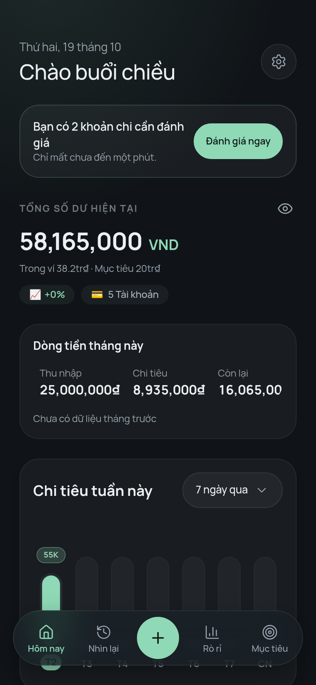<br><sub><b>Overview</b><br>balance, cash flow, reflection prompt</sub></td>
    <td align="center">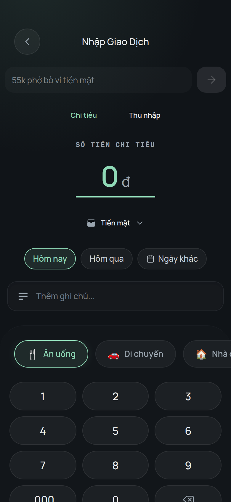<br><sub><b>Quick log</b><br>type a phrase or use the keypad</sub></td>
    <td align="center">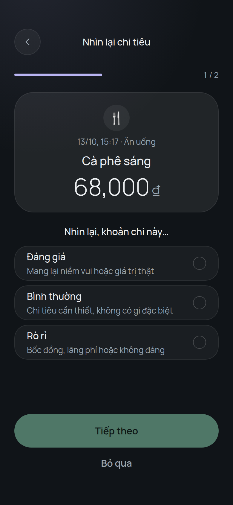<br><sub><b>Reflection ritual</b><br>worth it, neutral, or leak</sub></td>
    <td align="center">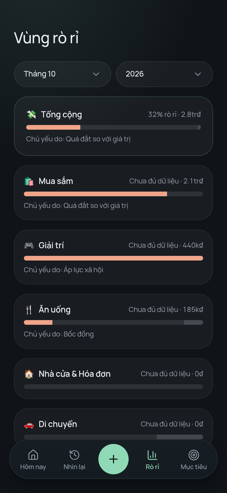<br><sub><b>Leak zones</b><br>leak rate per category</sub></td>
  </tr>
  <tr>
    <td align="center">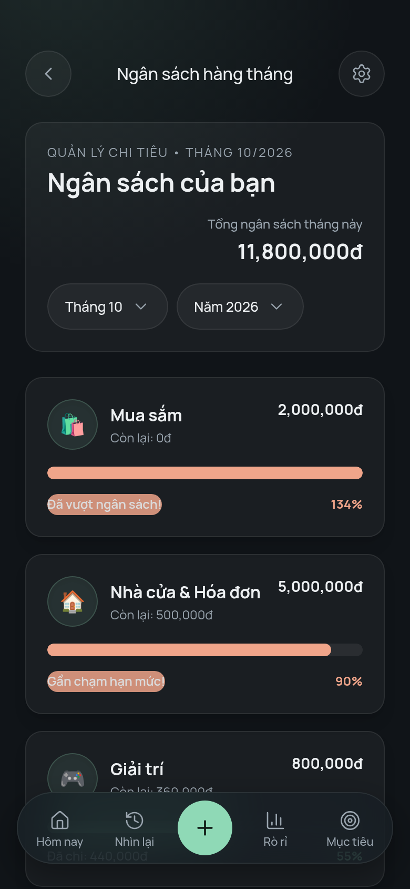<br><sub><b>Budgets</b><br>monthly limit per category</sub></td>
    <td align="center">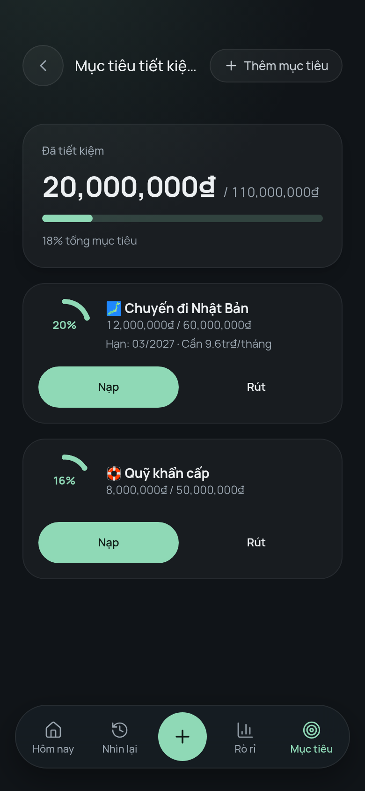<br><sub><b>Savings goals</b><br>deposit, withdraw, progress</sub></td>
    <td align="center">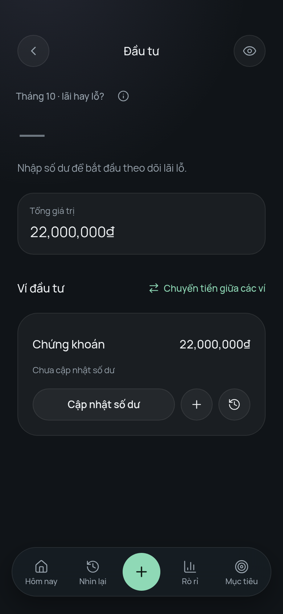<br><sub><b>Investments</b><br>balance updates, transfers</sub></td>
    <td></td>
  </tr>
</table>

> Screenshots are taken at a 390 px phone width from a local build with demo data. The demo data is made up.

---

## Table of contents

1. [How it fits together](#how-it-fits-together)
2. [Architecture](#architecture)
3. [Project structure](#project-structure)
4. [Screens and routes](#screens-and-routes)
5. [Project status](#project-status)
6. [Conventions](#conventions)
7. [Getting started](#getting-started)
8. [Scripts](#scripts)
9. [Build and deployment](#build-and-deployment)

---

## How it fits together

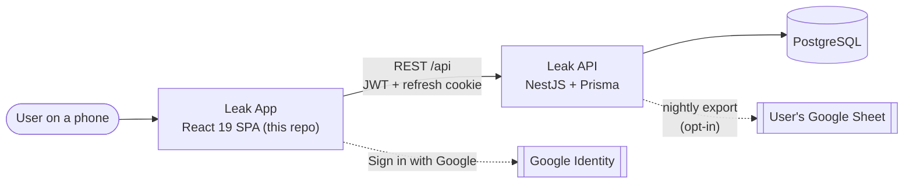

The SPA holds no business rules about money. Balances, leak rates, budgets and reclaim offers are computed by the API; the app only fetches, formats and displays them.

---

## Architecture

The code follows **Feature-Sliced Design (FSD)**. A layer may import only from layers below it, slices in the same layer never import each other, and every slice exposes a root `index.ts`.

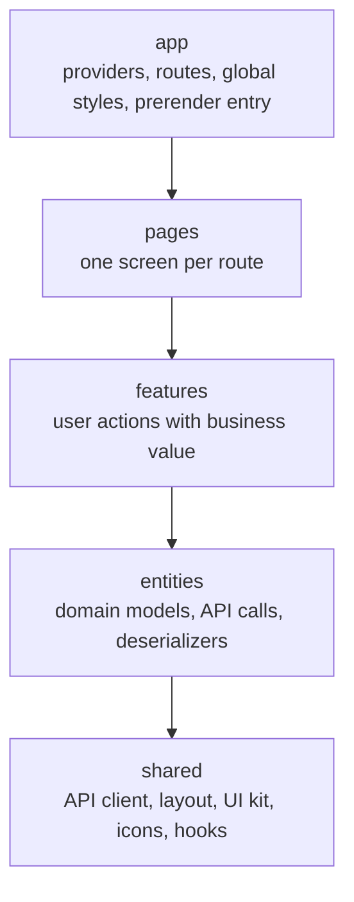

> There is no `widgets` layer yet. Pages compose features directly. The layer is reserved for blocks that several pages share.

### Data flow for one screen

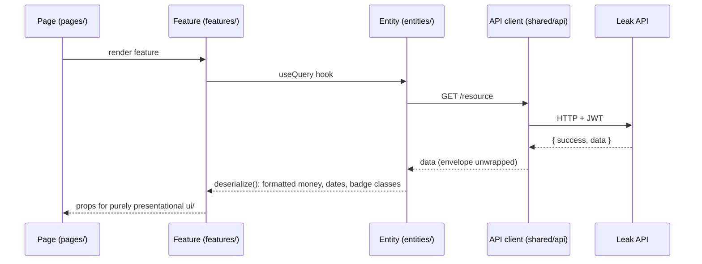

- **Server state** lives in TanStack Query. **Client state** (auth, onboarding, balance visibility) lives in small Zustand stores.
- **View-only UI.** Components under `ui/` do not format currency, parse dates or pick badge classes. That work happens in `deserialize.ts` so a component receives ready-to-render strings.
- **Auth.** The API client attaches the access token and refreshes it through the refresh-token cookie. Routes marked `protected` redirect to `/login`, and unfinished onboarding redirects to `/onboarding`.

---

## Project structure

```
app/
├── src/
│   ├── main.tsx                  # entry
│   ├── app/                      # App shell
│   │   ├── App.tsx
│   │   ├── routes.ts             # route table (protected / public / legacy redirects)
│   │   ├── providers/            # Auth, React Query, Google access token
│   │   ├── prerender/            # SSR entry used to pre-render public pages
│   │   └── styles/
│   ├── pages/                    # home, overview, transaction, add-transaction, reflect, leak-report,
│   │                             #   budget, budget-setup, wallet, savings-goals, investment, transfer,
│   │                             #   categories, profile, profile-buddy, profile-sync, profile-security, profile-sheets-report,
│   │                             #   login, register, forgot-password, reset-password, onboarding,
│   │                             #   privacy, terms, kit-gallery (dev only)
│   ├── features/                 # add-transaction, edit-transaction, quick-log, transaction-list,
│   │                             #   reflection-ritual, category-leak-rate, leak-reclaim, report-overview,
│   │                             #   manage-budget, manage-goals, manage-wallets, manage-categories,
│   │                             #   transfer-funds, update-balance, investment-overview,
│   │                             #   sync-google-sheets, manage-sessions, user-profile, buddy-settings, buddy-reaction,
│   │                             #   auth-by-email, auth-with-google, onboarding
│   ├── entities/                 # auth, session, user, wallet, category, transaction, transfer,
│   │                             #   budget, goal, valuation, notification
│   └── shared/                   # api, configs, hooks, icons (+ ICONS.md), layout, lib, routing, ui
├── public/                       # logo, env.js (runtime config), sheet-template
├── docker/40-runtime-env.sh      # writes env.js from container env at start
├── scripts/prerender.mjs         # bakes public pages into static HTML after the build
├── nginx.conf
├── Dockerfile                    # builder (Node) → runner (nginx)
├── DESIGN.md                     # design tokens, components, contrast ratios
└── docs/screenshots/             # images used in this README
```

Inside a slice, code is split by segment: `ui/` (presentational), `model/` (types, stores, hooks), `api/` (requests), `lib/` (helpers), `deserialize.ts` (formatting).

---

## Screens and routes

| Area       | Route                                                                                        | What it does                                                                                                          |
| :--------- | :------------------------------------------------------------------------------------------- | :-------------------------------------------------------------------------------------------------------------------- |
| Intro      | `/intro`, `/privacy`, `/terms`                                                               | Public pages, pre-rendered to static HTML at build time                                                               |
| Onboarding | `/onboarding`                                                                                | Six-step intro, shown once before login                                                                               |
| Auth       | `/login`, `/register`, `/forgot-password`, `/reset-password`                                 | Email and Google sign-in, password reset                                                                              |
| Overview   | `/overview`                                                                                  | Balance, monthly cash flow, weekly chart, reflection prompt, plug-the-leak offer                                      |
| Log        | `/log`, `/transactions/new`                                                                  | Quick-log phrase box, keypad, wallet, date, category                                                                  |
| History    | `/transactions`                                                                              | Filterable, infinite-scroll list, edit and delete                                                                     |
| Reflect    | `/reflect`                                                                                   | Card-by-card review of spends: worth it, neutral, or leak (with a reason)                                             |
| Leaks      | `/leaks`                                                                                     | Leak rate and main trigger per category, by month                                                                     |
| Budgets    | `/budgets`, `/budgets/setup`                                                                 | Monthly limit per category with progress                                                                              |
| Wallets    | `/wallets`                                                                                   | Cash, bank, e-wallet and investment accounts                                                                          |
| Goals      | `/goals`                                                                                     | Savings goals with deposit, withdraw and history                                                                      |
| Investment | `/investment`, `/transfer`                                                                   | Update an investment wallet's value, see capital vs. profit, move money between wallets                               |
| Categories | `/categories`                                                                                | Manage income, expense and investment categories                                                                      |
| Profile    | `/profile`, `/profile/buddy`, `/profile/sync`, `/profile/security`, `/profile/sheets-report` | Account and settings list; AI Buddy mode, Google Sheets sync, session list and report template each on their own page |

Old paths such as `/wallet`, `/budget` and `/savings-goals` redirect to the plural routes. In dev only, `/dev/kit` shows every UI kit component in its states.

---

## Project status

Version **0.0.5**, in active development. The core loop is complete. The open items are acceptance checks and Phase 2/3 features. The shared phase plan lives in the product roadmap kept with the repository.

### Shipped

| Feature                                                                                                                     |          State           |
| :-------------------------------------------------------------------------------------------------------------------------- | :----------------------: |
| Email and Google sign-in, password reset, session list and revoke                                                           |            ✅            |
| Onboarding                                                                                                                  |            ✅            |
| Wallets (liquid and investment) with ledger-backed balances                                                                 |            ✅            |
| Categories with emoji                                                                                                       |            ✅            |
| Transactions: add, edit, delete, filters, infinite scroll                                                                   |            ✅            |
| Quick-log phrase input (`55k phở bò ví tiền mặt` fills the form)                                                            |  🟡 acceptance pending   |
| Reflection ritual (worth it, neutral, leak and reason)                                                                      |            ✅            |
| Leak report: leak rate per category                                                                                         |            ✅            |
| Plug the leak: transfer saved leak money to a goal                                                                          |            ✅            |
| Budgets with threshold progress and setup flow                                                                              |            ✅            |
| Savings goals with deposit, withdraw, history                                                                               |            ✅            |
| Transfers between wallets                                                                                                   |            ✅            |
| Investment wallets: balance updates, profit/loss, portfolio view                                                            |         🟢 basic         |
| AI Buddy comments under transactions, mode setting (off until the privacy page is live and the API sets `AI_BUDDY_ENABLED`) | 🟡 built, off by default |
| Google Sheets sync card and report template                                                                                 |  🟡 acceptance pending   |
| Pre-rendered public pages (intro, privacy, terms)                                                                           |            ✅            |
| Docker image with runtime configuration                                                                                     |            ✅            |

✅ shipped · 🟢 working, basic · 🟡 built, still to be accepted in the running app

### Roadmap

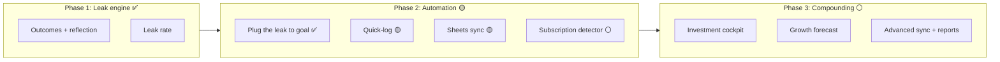

**Upcoming**

- Quick-log acceptance run and the under-5-seconds time-to-log check.
- AI Buddy acceptance on a scratch API, then switch it on in production (privacy page first, paid-tier Gemini key).
- Google Sheets sync acceptance against a real Google account.
- **Stealth subscription detector:** surface recurring charges, ask "still using it?" in the monthly review, flag unused ones as leaks with the yearly cost.
- **Investment cockpit:** asset classes (deposits, gold, stocks, real estate, crypto), cost basis, allocation chart.
- **Growth forecast:** show how reclaimed leak money compounds over 1, 3, 5 and 10 years.
- **Advanced export:** CSV/Excel, monthly reports.
- Backlog: recurring transactions, receipt attachments, budget rollover and alerts, sub-categories, multi-currency, email verification and 2FA.

### Known issues

- `yarn test`: `src/shared/configs/navigation.config.test.ts` fails because the Node test runner cannot resolve the `@/` import alias. The other tests pass.
- Overview: the "Còn lại" (remaining) figure in the cash-flow card is cut off at 390 px width when the number has eight digits or more.
- CI builds and publishes the image but does not run lint or tests.

---

## Conventions

- **Language:** Vietnamese for everything the user sees (labels, toasts, empty states, validation). English for code, names, props, schemas and comments.
- **Models:** domain interfaces end in `Model` (`TransactionModel`, `WalletModel`).
- **Design system:** DaisyUI semantic classes first, Tailwind utilities second. Interactive elements are at least 44×44 px. Icons come only from `shared/icons` (outline, stroke 1.75–2); do not add an icon package. Tokens and contrast ratios are in [`DESIGN.md`](./DESIGN.md).
- **Commits:** [Conventional Commits](https://www.conventionalcommits.org/) (`feat:`, `fix:`, `refactor:`, `chore:`, `docs:`), checked by Husky and Commitlint.

---

## Getting started

### Prerequisites

- Node.js 24 (see `.nvmrc`; the Docker image uses Node 22)
- Yarn
- A running [Leak API](../api) (default `http://localhost:3000/api`)

### Run locally

```bash
yarn install
cp .env.example .env     # then set the two variables below
yarn dev                 # http://localhost:5173
```

| Variable                | Purpose                                                                                                                |
| :---------------------- | :--------------------------------------------------------------------------------------------------------------------- |
| `VITE_BASE_API_URL`     | Base URL of the API. Defaults to `http://localhost:3000/api`                                                           |
| `VITE_GOOGLE_CLIENT_ID` | Google OAuth web client ID for "Sign in with Google". Add `http://localhost:5173` to its authorized JavaScript origins |

The API must list the app's origin in its `CORS_ORIGINS` (`http://localhost:5173` for local development).

---

## Scripts

| Command        | What it does                                                                      |
| :------------- | :-------------------------------------------------------------------------------- |
| `yarn dev`     | Vite dev server with hot reload                                                   |
| `yarn build`   | Type-check, build the SPA, build the SSR bundle, then pre-render the public pages |
| `yarn preview` | Serve the production build locally                                                |
| `yarn test`    | Unit tests with the Node test runner (`src/**/*.test.ts`)                         |
| `yarn lint`    | ESLint and Prettier on staged files (`lint-staged`)                               |

---

## Build and deployment

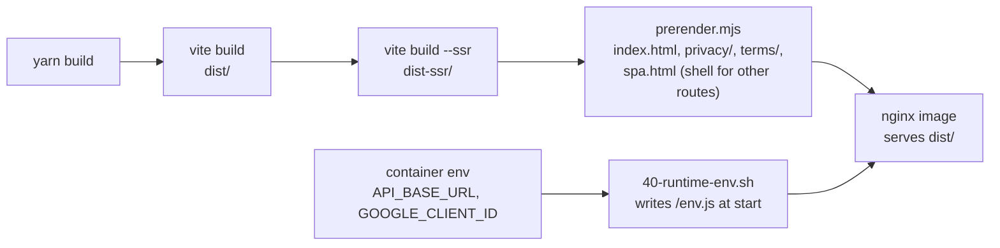

- The output is static, so any static host works. The supplied `Dockerfile` builds the bundle and serves it with nginx.
- **Runtime configuration:** the image does not bake the API URL. On start, `docker/40-runtime-env.sh` writes `/env.js` from `API_BASE_URL` (default `/api`) and `GOOGLE_CLIENT_ID`, so one image works in every environment.
- **Pre-rendering:** the intro, privacy and terms pages are written as real HTML so crawlers that do not run JavaScript (Google's OAuth verification, for one) can read them. Every other route falls back to `spa.html`.
- The GitHub workflow in `.github/workflows` publishes the image to GHCR.
